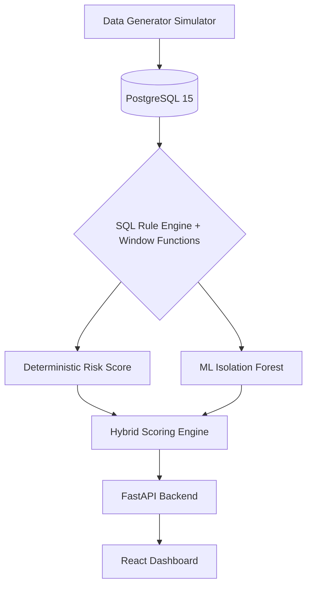

# Hybrid Fraud Detection Engine

A production-ready, full-stack Transaction Anomaly Detection engine that combines the explainability of deterministic SQL rules with the probabilistic power of Machine Learning.


## Features

- **Live Transaction Simulator**: Continuously generates realistic financial transactions in the background based on distinct customer behavioral profiles, injecting specific fraud vectors mixed with standard traffic.
- **Advanced SQL Detection Layer**: Utilizes PostgreSQL Window Functions and CTEs to evaluate complex fraud rules in real-time:
  - **High-Velocity Card Testing**: Detects rapid successive transactions.
  - **Value Anomalies**: Calculates a rolling Z-Score based on the user's historical spend.
  - **Impossible Travel**: Calculates physical speed between consecutive transactions using the `earthdistance` extension to flag unrealistic movement.
  - **Micro-Charge Testing**: Identifies patterns of small authorizations that often precede large-scale fraud.
  - **Cross-Border Fraud**: Flags sudden shifts to foreign merchants.
  - **Late-Night Anomalies**: Flags suspicious transactions occurring outside of standard regional hours.
  - **Rapid Category Hopping**: Detects sudden shifts in merchant category spending behavior.
- **9-Dimensional Machine Learning**: Implements an unsupervised `IsolationForest` AI model trained on SQL-engineered features. The model calculates dynamic contamination thresholds to detect subtle, multi-variable fraud vectors that bypass rigid rules.
- **Premium React Dashboard**: A dark-mode, auto-refreshing investigation dashboard built with Vite, Tailwind CSS, and Recharts for live threat monitoring.

## Architecture



## Quick Start (Docker)

This project is fully containerized. No local Python or Node.js environment is required to run the application.

### 1. Clone the repository
```bash
git clone https://github.com/shaik-hasan-AS/Transaction-anomaly-detection-Engine.git
cd Transaction-anomaly-detection-Engine
```

### 2. Start the Stack
Bring up the database, FastAPI backend, and React frontend.
```bash
docker compose up --build -d
```

### 3. Seed the Database
As the database initializes empty, run the realistic data generator inside the backend container to simulate customers, merchants, and transactions.
```bash
docker compose exec backend python ../data/generate_data.py
```

### 4. Train the AI Model
Train the 9-dimensional Isolation Forest model on the generated dataset.
```bash
docker compose exec backend python ../ml/train_isolation_forest.py
```

### 5. Access the Dashboard
Navigate to [http://localhost:5173/](http://localhost:5173/) in your web browser. 

The dashboard will populate with the generated data. The live simulator will continuously generate new transactions in the background.

## Manual Development Setup

To run the components locally without Docker:

**1. Database**
```bash
docker compose up db -d
```

**2. Backend API**
```bash
cd backend
python -m venv venv
source venv/bin/activate
pip install -r requirements.txt
python ../data/generate_data.py
python ../ml/train_isolation_forest.py
uvicorn main:app --reload
```

**3. Frontend**
```bash
cd frontend
npm install
npm run dev
```
