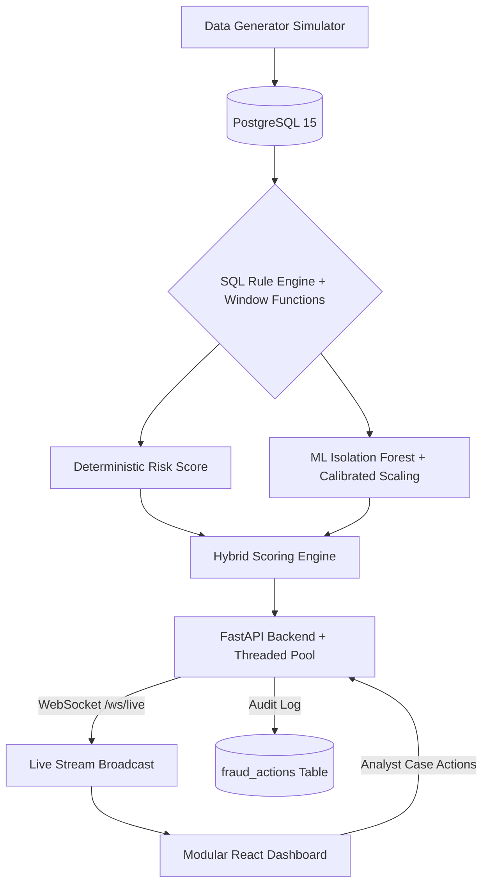

# Hybrid Fraud Detection Engine

A production-ready, full-stack Transaction Anomaly Detection engine that combines the explainability of deterministic SQL rules with the probabilistic power of Machine Learning.


## Features

- **Live Transaction Simulator & Real-Time WebSocket Streaming**: Continuously generates realistic financial transactions in the background and pushes them instantly to connected dashboards over a persistent WebSocket connection (`/ws/live`).
- **Advanced SQL Detection Layer**: Utilizes PostgreSQL Window Functions, CTEs, and geospatial extensions (`cube`, `earthdistance`) to evaluate complex fraud rules in real-time:
  - **High-Velocity Card Testing**: Detects rapid successive authorizations.
  - **Value Anomalies**: Calculates a rolling Z-Score based on customer historical spend.
  - **Impossible Travel**: Calculates physical speed between consecutive transactions to flag unrealistic movement (>1,000 km/h).
  - **Micro-Charge Testing**: Identifies small authorization probing (<$2.00) that often precedes larger attacks.
  - **Cross-Border Fraud**: Flags sudden shifts to foreign merchants.
  - **Late-Night Anomalies**: Flags suspicious transactions occurring outside regional daylight hours.
  - **Rapid Category Hopping**: Detects erratic shifts across merchant categories.
- **Calibrated 9-Dimensional Machine Learning**:
  - Implements an unsupervised `IsolationForest` model with continuous percentile-based score calibration.
  - **SHAP-Style Feature Attribution**: Provides transparent feature importance breakdowns inside the investigation drawer to explain *why* the ML model flagged each anomaly.
- **Analyst Case Management & Audit Trail**:
  - Direct analyst actions from the dashboard: **Block Card**, **Mark False Positive**, and **Request KYC**.
  - Persistent resolution audit logging in PostgreSQL (`fraud_actions`) with notes and operator attribution.
- **High-Performance Backend**:
  - Threaded connection pooling (`psycopg2.pool.ThreadedConnectionPool`) with FastAPI lifespan resource management.
  - Single-pass query pipeline eliminating redundant SQL passes.
- **Premium Modular React Dashboard**:
  - Dark-mode interface built with Vite, CSS design system, and Recharts.
  - Real-time live status indicator with pulsing animation.
  - Zero-dependency Web Audio API audio alerts for critical anomalies (risk ≥ 80).
  - Floating interactive threat notification toasts with one-click drill-down.

## Architecture



## Quick Start (Docker)

This project is fully containerized. No local Python or Node.js environment is required.

### 1. Clone the repository
```bash
git clone https://github.com/shaik-hasan-AS/Hybrid-Fraud-Detection-Engine.git
cd Hybrid-Fraud-Detection-Engine
```

### 2. Start the Stack
Bring up the database, FastAPI backend, and React frontend:
```bash
docker compose up --build -d
```

### 3. Seed the Database
Seed customers, merchants, cards, and historical transactions:
```bash
docker compose exec backend python ../data/generate_data.py
```

### 4. Train the Calibrated ML Model
Train the Isolation Forest model and generate percentile calibration metadata:
```bash
docker compose exec backend python ../ml/train_isolation_forest.py
```

### 5. Access the Dashboard
Navigate to [http://localhost:5173/](http://localhost:5173/) in your web browser. 

The dashboard connects to the live WebSocket stream, rendering real-time incoming transactions, sound alerts for critical threats, and analyst case management tools.

## Manual Development Setup

To run the components locally without Docker:

**1. Database**
```bash
docker compose up db -d
```

**2. Backend API**
```bash
cd backend
python -m venv venv
source venv/bin/activate
pip install -r requirements.txt
python ../data/generate_data.py
python ../ml/train_isolation_forest.py
uvicorn main:app --reload --port 8000
```

**3. Frontend**
```bash
cd frontend
npm install
npm run dev
```
