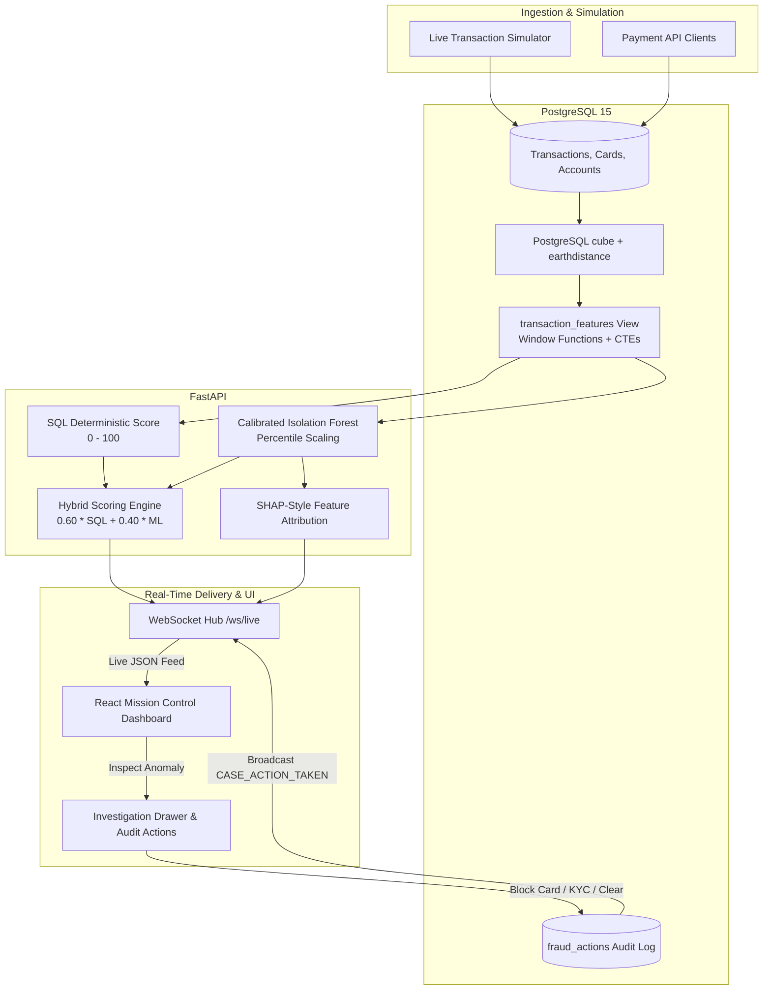
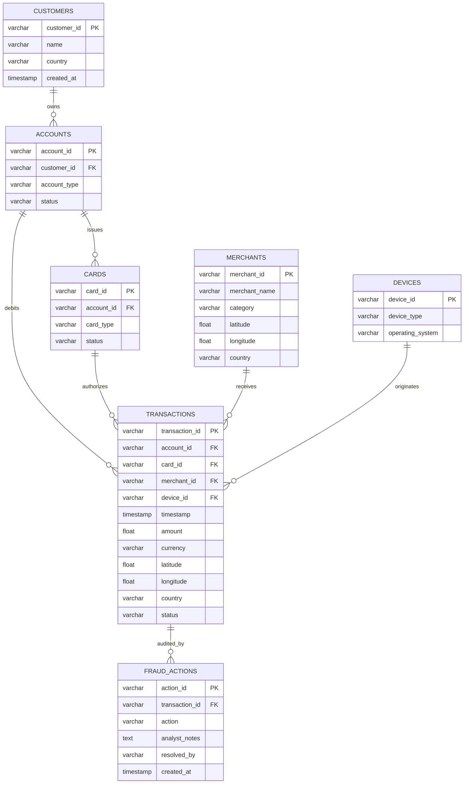

# 🛡️ Hybrid Fraud Detection Engine

[](https://www.python.org/)
[](https://fastapi.tiangolo.com/)
[](https://react.dev/)
[](https://vitejs.dev/)
[](https://www.postgresql.org/)
[](https://scikit-learn.org/)
[](https://www.docker.com/)

A high-throughput, full-stack **Transaction Anomaly Detection & Fraud Investigation Engine**. The platform fuses the deterministic explainability of **PostgreSQL Window Functions and Geospatial Rules** with the probabilistic pattern-recognition of an **Isolation Forest Machine Learning model**, streaming real-time alerts to a mission-control analyst dashboard over WebSockets.

---

## 📑 Table of Contents

- [Overview & Architecture](#-overview--architecture)
- [Key Features](#-key-features)
- [Detection Engine Breakdown](#-detection-engine-breakdown)
  - [1. Deterministic SQL Rule Layer (8 Rules)](#1-deterministic-sql-rule-layer-8-rules)
  - [2. Calibrated 9D Machine Learning Layer](#2-calibrated-9d-machine-learning-layer)
  - [3. Hybrid Ensemble Scoring Formula](#3-hybrid-ensemble-scoring-formula)
- [Analyst Case Management & Audit Trail](#-analyst-case-management--audit-trail)
- [API & WebSocket Reference](#-api--websocket-reference)
- [Database Schema & Relational Design](#-database-schema--relational-design)
- [Quick Start (Docker Compose)](#-quick-start-docker-compose)
- [Manual Local Development Setup](#-manual-local-development-setup)
- [Environment Variables](#-environment-variables)
- [Repository Structure](#-repository-structure)

---

## 🏛️ Overview & Architecture

Modern financial crime bypasses isolated static checks. Fraud patterns emerge across **temporal sequences**, **geospatial leaps**, **behavioral deviations**, and **probabilistic correlations**. 

The **Hybrid Fraud Detection Engine** bridges database-level stream processing with predictive AI:

1. **Deterministic Rule Engine (SQL View)**: Evaluates high-speed window functions and geospatial math in PostgreSQL, producing audit-compliant, explainable risk flags.
2. **Probabilistic Anomaly Model (ML)**: Evaluates a 9-dimensional continuous feature space using a calibrated `IsolationForest` to catch novel, multi-variate attack vectors.
3. **Ensemble Risk Engine**: Blends deterministic precision (60%) with unsupervised machine learning (40%).
4. **Reactive WebSocket Pipeline**: Streams live simulated payment activity, broadcasts audio-visual security alerts, and synchronizes analyst actions across operator sessions.



---

## ✨ Key Features

- **Live Transaction Simulator**: Generates realistic multi-currency financial authorizations across global hubs (New York, London, Tokyo, Sydney, Toronto) with stochastic fraud injection.
- **Persistent WebSocket Streaming (`/ws/live`)**: Streams incoming transactions and cross-analyst case actions with auto-reconnection and heartbeat ping/pong.
- **8 Deterministic SQL Detection Rules**: Native PostgreSQL CTEs and window functions detecting card testing, impossible travel, value anomalies, foreign spend, and off-hour activity.
- **9-Dimensional Isolation Forest**: Calibrated with empirical percentile scaling (1st, 50th, 99th percentiles) to prevent score saturation.
- **SHAP-Style Feature Explainability**: Generates attribution breakdowns inside the investigation drawer showing exactly which features triggered the ML flag.
- **End-to-End Analyst Case Management**: Direct workflow resolution tools (**Block Card**, **Mark False Positive**, **Request KYC**, **Resolve Alert**) with immutable audit logging (`fraud_actions`).
- **High-Performance Database Pooling**: Thread-safe `ThreadedConnectionPool` (2–20 connections) managed via FastAPI application lifespan.
- **Single-Pass Query Architecture**: Fetches presentation attributes and ML feature inputs in a unified SQL query to eliminate duplicate round-trips.
- **Mission Control React Dashboard**: Dark-mode terminal styling, Recharts telemetry, audio alarms powered by the zero-dependency Web Audio API, and interactive drill-down threat toasts.

---

## 🔍 Detection Engine Breakdown

### 1. Deterministic SQL Rule Layer (8 Rules)

All deterministic rules run inside PostgreSQL within the optimized `transaction_features` view using window functions (`OVER (PARTITION BY ... ORDER BY ...)`):

| # | Rule Name | SQL Implementation & Condition | Weight | Rationale |
|---|---|---|---|---|
| 1 | **High-Velocity Card Testing** | `COUNT(*) OVER (PARTITION BY card_id ... RANGE '2 minutes' PRECEDING) >= 5` | **+60** | Rapid bot-driven card authorization enumeration. |
| 2 | **Transaction Amount Anomaly** | `(amount - AVG(amount)) / NULLIF(STDDEV(amount), 0) >= 3.0` | **+45** | Statistically anomalous spending spike relative to account history ($Z \ge 3.0$). |
| 3 | **Impossible Travel** | `earth_distance(ll_to_earth(...), ll_to_earth(...)) / time_diff_hours > 1000` | **+80** | Physical movement speed between consecutive card swipes exceeds 1,000 km/h. |
| 4 | **New Device Detection** | `NOT EXISTS (SELECT 1 FROM transactions WHERE account_id = a AND device_id = d AND ts < cur_ts)` | **+20** | First time an account has transacted from this specific hardware identifier. |
| 5 | **Cross-Border / Foreign Merchant** | `merchant_country != customer_country` | **+20** | Sudden international authorization shift from customer's home jurisdiction. |
| 6 | **Late-Night Anomalies** | `EXTRACT(HOUR FROM timestamp) BETWEEN 1 AND 5` | **+15** | Transactions occurring during high-risk local sleeping hours (01:00–05:00). |
| 7 | **Micro-Charge Probing** | `SUM(CASE WHEN amount < 2.00 THEN 1 ELSE 0 END) OVER (24h Window) >= 3` | **+40** | Low-value card validity testing before executing large unauthorized withdrawals. |
| 8 | **Rapid Category Hopping** | `category_change_flag = 1 AND time_diff_hours < 1.0` | **+10** | Erratic merchant category shifts in under 60 minutes. |

> **Score Normalization**: The cumulative SQL risk score is capped at `100` via PostgreSQL `LEAST(100, (weight_1 + weight_2 + ...))`.

---

### 2. Calibrated 9D Machine Learning Layer

The machine learning component runs an **Isolation Forest** trained on 9 behavioral dimensions extracted directly from historical transaction features:

```
ML Feature Vector = [
    amount,                   # Transaction monetary value
    velocity_count,           # Rolling 2-minute transaction count
    z_score,                  # Spending deviation score
    travel_speed_kmh,         # Velocity between consecutive locations (km/h)
    new_device_flag,          # Binary: 1 if hardware never seen for account
    micro_charge_count,       # Sub-$2.00 transactions in rolling 24h
    category_change_flag,     # Binary: 1 if merchant category switched
    rule_foreign_transaction, # Binary: 1 if cross-border
    rule_late_night           # Binary: 1 if between 01:00 and 05:00
]
```

#### Percentile-Based Score Calibration
Raw Isolation Forest `decision_function` values can be skewed and difficult for human analysts to interpret. During training (`ml/train_isolation_forest.py`), empirical distribution percentiles are calculated and exported to `ml/models/model_meta.json`:
- $P_{01}$ (1st percentile, extreme anomaly threshold)
- $P_{50}$ (median benign transaction score)
- $P_{99}$ (99th percentile)

The backend normalizes raw inference scores onto a smooth `0–100` continuum:

$$\text{Normalized Risk} = \text{clip}\left( \frac{P_{50} - \text{score}}{P_{50} - P_{01}} \times 100, 0, 100 \right)$$

#### Explainable Feature Attribution (SHAP-Style)
For any transaction flagged by the ML model, the backend calculates the normalized deviation of each feature against benign baselines:

$$\text{Deviation}_i = \max\left(0, \frac{x_i - \text{median}_i}{\text{std}_i}\right)$$

Top contributing drivers are computed and returned as percentage impact figures in the investigation drawer.

---

### 3. Hybrid Ensemble Scoring Formula

The final **Hybrid Risk Score** combines the explainable rule score with the machine learning anomaly score:

$$\text{Hybrid Risk Score} = \operatorname{round}\left( 0.60 \times \text{SQL Risk Score} + 0.40 \times \text{ML Risk Score} \right)$$

#### Alert Classification Tiers

| Hybrid Risk Score | Severity Band | Dashboard Treatment | Audio Alert |
|---|---|---|---|
| **80 – 100** | 🔴 **Critical** | Red pulsing border, Threat Toast pop-up | High-frequency dual beep |
| **60 – 79** | 🟠 **High** | Orange badge, high-priority queue | — |
| **40 – 59** | 🟡 **Medium** | Yellow badge, review flag | — |
| **0 – 39** | 🟢 **Low / Clean** | Green badge, normal activity | — |

---

## 🛡️ Analyst Case Management & Audit Trail

When an investigator opens a transaction in the **Investigation Drawer**, they have full situational context:
- Complete transaction metadata and geographical coordinates.
- Behavioral rule triggers with exact calculated metrics (e.g., Z-Score, Travel Speed in km/h).
- ML feature attribution ranking explaining why the Isolation Forest flagged the record.
- Historical account timeline displaying the last 10 transactions.
- Historical audit log showing previous actions taken on this transaction.

### Available Analyst Actions:
1. **`BLOCK_CARD`**: Immediately disables the payment card in the `cards` table (`status = 'BLOCKED'`) and marks the transaction as blocked.
2. **`FALSE_POSITIVE`**: Clears the transaction risk flag (`status = 'CLEARED'`) and logs the decision with notes.
3. **`REQUEST_KYC`**: Flags the customer account for mandatory identity re-verification.
4. **`RESOLVED`**: Closes the alert inquiry.

All resolutions are recorded immutably in the `fraud_actions` audit table with timestamp, operator ID (`resolved_by`), and notes, followed by an immediate broadcast to all connected dashboards via WebSocket (`CASE_ACTION_TAKEN`).

---

## 📡 API & WebSocket Reference

### REST Endpoints

| Method | Endpoint | Description | Query / Body Parameters |
|---|---|---|---|
| `GET` | `/transactions` | Fetch paginated transactions | `limit` (int, default 100), `offset` (int, default 0), `sort_by_risk` (bool, default true) |
| `GET` | `/analytics/summary` | Global engine statistics & rule counters | None |
| `GET` | `/transactions/{id}/investigate` | Detailed transaction report, ML explainability, 10-tx history, and audit log | Path param: `transaction_id` (str) |
| `POST` | `/transactions/{id}/action` | Submit analyst case resolution | Body: `{"action": "BLOCK_CARD \| FALSE_POSITIVE \| REQUEST_KYC \| RESOLVED", "analyst_notes": "...", "resolved_by": "analyst_1"}` |

### WebSocket Endpoint (`/ws/live`)

- **URL**: `ws://localhost:8000/ws/live`
- **Client Keep-Alive**: Send `"ping"` $\rightarrow$ Receives `"pong"`.
- **Server Events**:
  - `NEW_TRANSACTION`: Emitted whenever the background simulator or ingestion pipe registers an evaluated transaction.
  - `CASE_ACTION_TAKEN`: Broadcasts whenever an analyst blocks a card or resolves an alert.

```json
// Example NEW_TRANSACTION payload
{
  "type": "NEW_TRANSACTION",
  "data": {
    "transaction_id": "c138f36c-9dd1-4277-bc6d-ba130421e42f",
    "account_id": "acc_001",
    "amount": 1420.50,
    "sql_risk_score": 80,
    "ml_risk_score": 88,
    "hybrid_risk_score": 83,
    "rule_impossible_travel": true,
    "travel_speed_kmh": 1450.2,
    "timestamp": "2026-10-13T12:45:00.000Z"
  }
}
```

---

## 🗄️ Database Schema & Relational Design

The engine runs on **PostgreSQL 15** with spatial acceleration enabled via the `cube` and `earthdistance` extensions.



---

## 🚀 Quick Start (Docker Compose)

The entire ecosystem (PostgreSQL 15 + DB initialization scripts + FastAPI backend + React frontend) runs in Docker with zero host dependencies.

### 1. Clone the repository
```bash
git clone https://github.com/shaik-hasan-AS/Hybrid-Fraud-Detection-Engine.git
cd Hybrid-Fraud-Detection-Engine
```

### 2. Launch the Stack
```bash
docker compose up --build -d
```

### 3. Seed Synthetic Data
Generate customers, merchants, devices, cards, and realistic transactions:
```bash
docker compose exec backend python ../data/generate_data.py
```

### 4. Train the ML Isolation Forest
Train the model on the generated database features and export calibration metadata:
```bash
docker compose exec backend python ../ml/train_isolation_forest.py
```

### 5. Access the Platform
- **Analyst Dashboard**: [http://localhost:5173/](http://localhost:5173/)
- **FastAPI Interactive Docs (Swagger)**: [http://localhost:8000/docs](http://localhost:8000/docs)
- **Database Port**: `localhost:5433` (mapped from container 5432)

---

## 💻 Manual Local Development Setup

If you prefer running services directly on your host machine:

### 1. Start PostgreSQL with Extensions
```bash
docker compose up db -d
```
*(PostgreSQL will boot on `localhost:5433` with `fraud_db`, `schema.sql`, and `rules.sql` initialized).*

### 2. Set Up Backend & Train Model
```bash
cd backend
python -m venv venv
source venv/bin/activate
pip install -r requirements.txt

# Seed synthetic customer and transaction history
python ../data/generate_data.py

# Train calibrated Isolation Forest
python ../ml/train_isolation_forest.py

# Launch FastAPI development server
uvicorn main:app --reload --port 8000
```

### 3. Launch the Frontend
In a new terminal window:
```bash
cd frontend
npm install
npm run dev
```
Open [http://localhost:5173/](http://localhost:5173/) in your browser.

---

## ⚙️ Environment Variables

The backend and data scripts automatically recognize the following configuration variables:

| Variable | Default (Local) | Default (Docker) | Description |
|---|---|---|---|
| `DB_NAME` | `fraud_db` | `fraud_db` | PostgreSQL database name |
| `DB_USER` | `fraud_user` | `fraud_user` | Database username |
| `DB_PASSWORD` | `fraud_password` | `fraud_password` | Database user password |
| `DB_HOST` | `localhost` | `db` | Database host address |
| `DB_PORT` | `5433` | `5432` | Database port (5433 for external host, 5432 inside Docker network) |

---

## 📂 Repository Structure

```
Hybrid-Fraud-Detection-Engine/
├── backend/
│   ├── Dockerfile                 # Python 3.10 slim container definition
│   ├── main.py                    # FastAPI server, WebSocket hub, pool & ML inference
│   └── requirements.txt           # Python dependencies (FastAPI, scikit-learn, psycopg2, etc.)
├── data/
│   └── generate_data.py           # Synthetic financial data generator with Faker
├── database/
│   └── schema.sql                 # DDL tables, foreign keys, and B-tree indexes
├── sql/
│   └── rules.sql                  # Analytical SQL view (transaction_features) with window rules
├── ml/
│   ├── train_isolation_forest.py  # Model trainer with percentile calibration
│   └── models/                    # Serialized model (.joblib) and calibration metadata (.json)
├── frontend/
│   ├── Dockerfile                 # Node.js container definition
│   ├── package.json               # Frontend dependencies (React 19, Vite, Recharts, Lucide)
│   ├── vite.config.js             # Vite bundler configuration
│   └── src/
│       ├── App.jsx                # Main layout, WebSocket lifecycle, charts & risk queues
│       ├── index.css              # Cyberpunk-inspired dark-mode CSS design system
│       └── components/
│           ├── InvestigationDrawer.jsx # Slide-out case management, SHAP explainability & actions
│           ├── MetricCard.jsx          # Live telemetry statistics cards
│           ├── ThreatToast.jsx         # Critical threat toast notification
│           └── TransactionItem.jsx     # Live transaction feed card
├── docker-compose.yml             # Multi-container orchestration definition
└── README.md                      # Comprehensive project documentation
```

---

## 📄 License & Attribution

Distributed under the MIT License. Developed for enterprise fraud operations and financial technology risk management teams.
